# Kinnect

**A group project coordination and progress monitoring system for classes.**

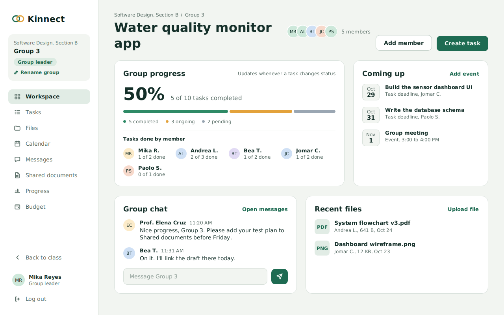

## What is Kinnect?

Group projects are a big part of school, but keeping a group organized is hard. Tasks get assigned in group chats and forgotten, files are scattered across different apps, nobody is sure who is doing what, and the professor only sees the result at the very end.

Kinnect puts the whole group project in one place. It is a desktop program where a professor sets up classes and groups, a group leader divides the work into tasks, and each member updates the status of their own tasks. Every group gets its own workspace with tasks, files, a calendar, messages, shared documents, and a budget, and a progress dashboard shows how far along the group is at any moment. Because everyone connects to the same database, a change made on one computer appears on everyone else's.

Author: Ariel Soriano

## How a class uses Kinnect

**1. The professor creates a class.** Kinnect gives the class a unique code, like `KQ7-4MX`, which the professor shares with the students.

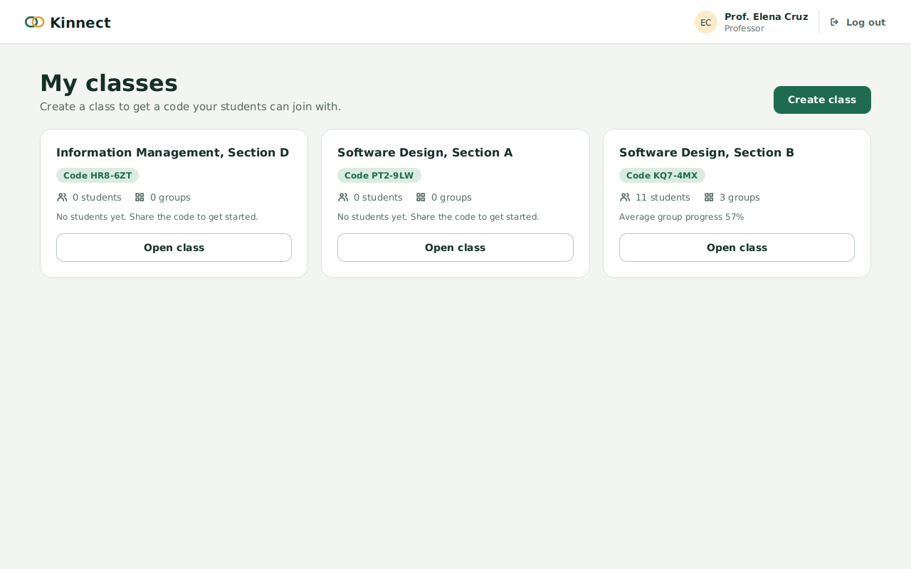

**2. Students join with the code.** Each student signs up, enters the class code, and appears in the professor's list of students.

**3. The professor forms the groups.** The professor creates each group, gives it a name and project title, and chooses its group leader. A student can only belong to one group per class.

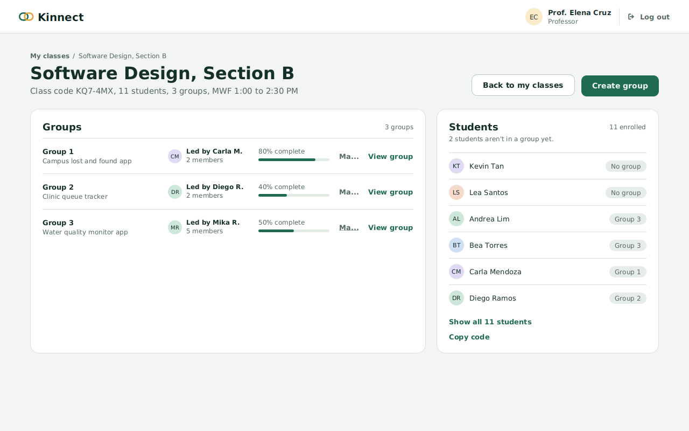

**4. The leader builds the team and assigns the work.** The group leader adds classmates to the group, then creates tasks. Each task has a title, a description, a deadline, and the member responsible for it.

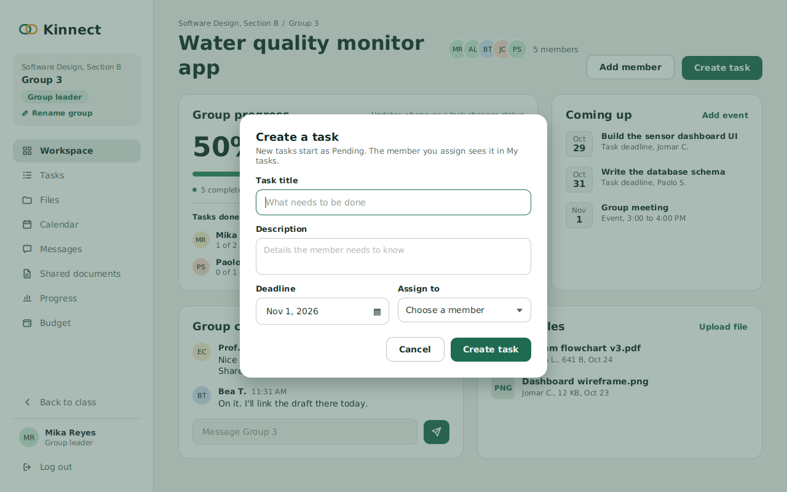

**5. Members do the work and update their tasks.** Each member sees only the tasks assigned to them and moves each one from Pending to Ongoing to Completed. Only the assigned member can change a task's status, so the record shows who actually did what.

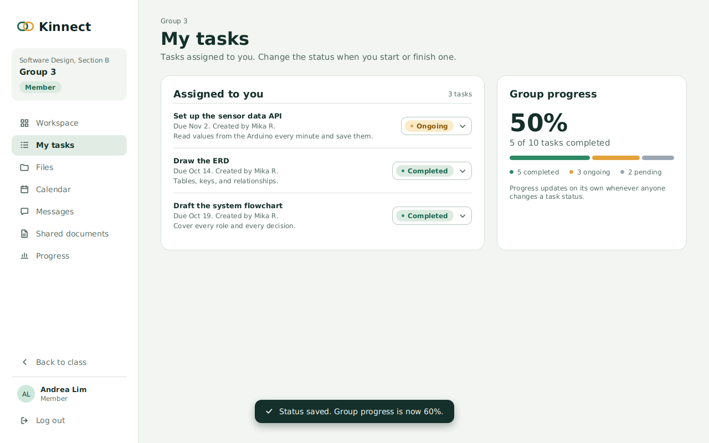

**6. Everyone sees the progress.** Every status change updates the group's progress dashboard right away. It shows the percentage of tasks completed, what is ongoing and pending, and how much each member has finished. The professor can open any group in the class and check its progress without waiting for the final output.

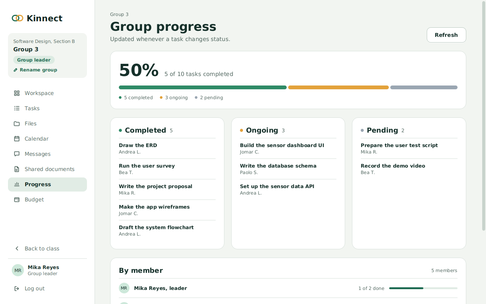

## What each role can do

| Role | What they can do |
|---|---|
| Professor | Creates classes and groups, and chooses each group's leader. Can rename a group, change its leader, add students, and remove members who have no work yet. Can lock a group's name so the leader can't change it. Sees every group's workspace, tasks, progress, files, calendar, documents, and messages, and can chat with any group. |
| Group leader | Adds classmates to the group, creates and assigns tasks, sees every task in the group, renames the group unless the professor locked the name, and manages the group budget. Also does everything a member can. |
| Member | Sees their own tasks and updates their status. Uploads and downloads files, adds calendar events, shares document links, and chats with the group. |

## Inside a group workspace

Every group has its own workspace, and each part has one job.

| Part | What it does |
|---|---|
| **Workspace** | The group's home page: overall progress, upcoming deadlines and events, the latest messages, and recently uploaded files. |
| **Tasks** | Every task in the group with its assignee, deadline, and status, filtered by All, Assigned to me, Pending, Ongoing, or Completed. |
| **Progress** | A dashboard of completed, ongoing, and pending tasks for the whole group and for each member. |
| **Files** | A shared file manager. Files are saved in the database itself, so every member and the professor can open or download them from any computer. |
| **Calendar** | A monthly calendar that shows group events together with task deadlines, so nobody misses a date. |
| **Messages** | A group chat between the members and the professor. New messages appear on their own every few seconds. |
| **Shared documents** | A list of links to documents kept elsewhere, such as Google Docs, with who shared each one and when. |
| **Budget (ambagan)** | For the leader only. Tracks the project's expenses and splits the total among the members. |

| | |
|---|---|
| 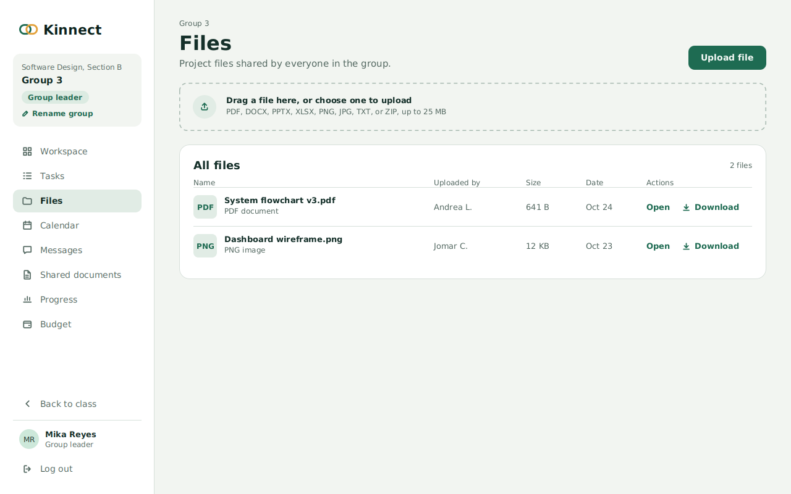 | 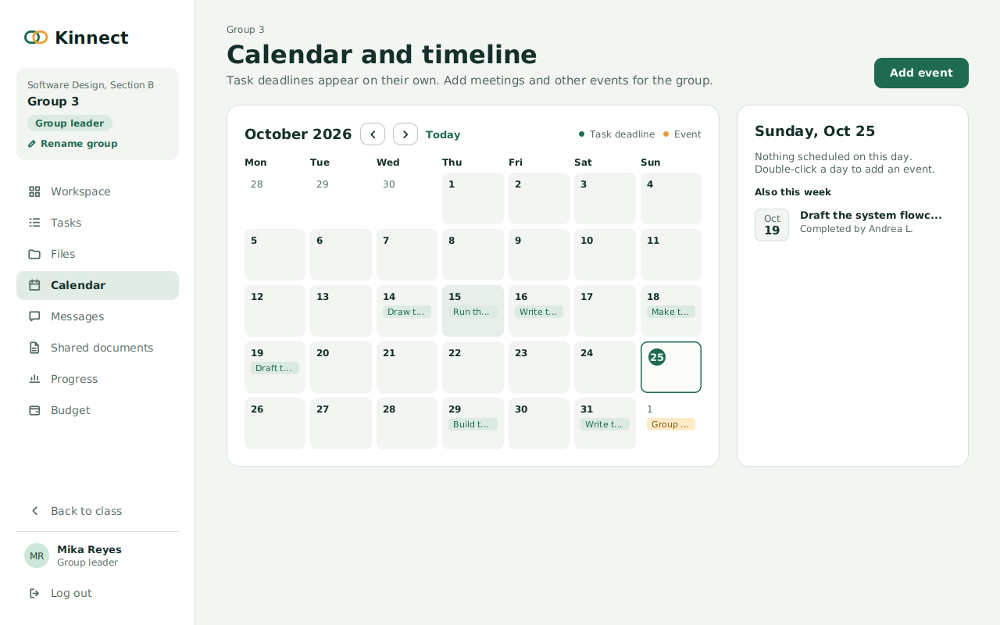 |
| Shared files | Calendar with events and deadlines |
| 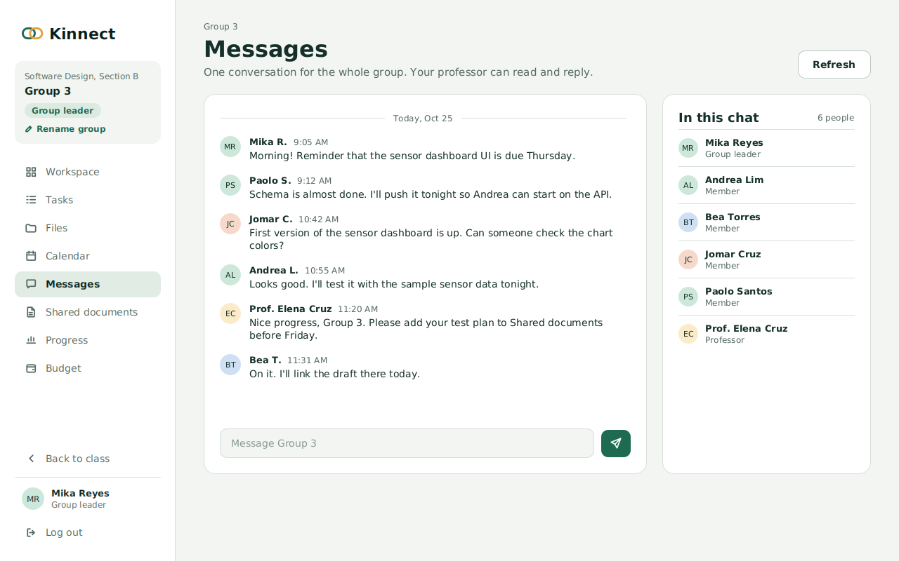 | 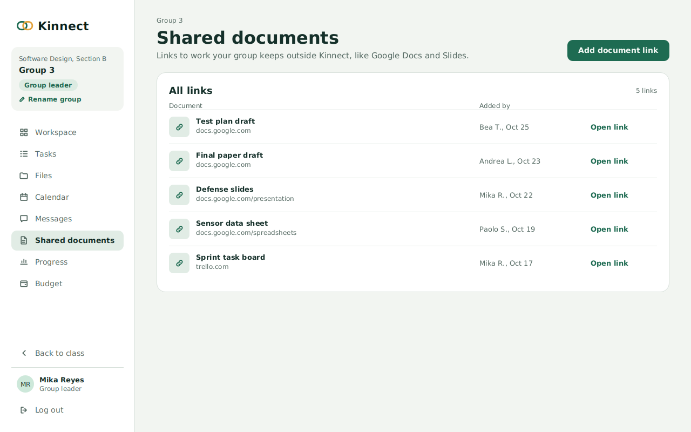 |
| Group messages | Shared document links |

## The group budget (ambagan)

Group projects often cost money, for materials, printing, or prototypes, and collecting everyone's share is easy to lose track of. The budget page handles this for the leader.

The leader lists each expense as planned or already bought. Kinnect adds up the total and splits it evenly among the members, rounded up to the next peso. If a member agrees to pay more, the leader can give them a custom share, and the rest is split evenly among everyone else. Members can pay in full or in parts, and the page shows who is fully paid and how much each person still owes. If an expense changes later, everyone's balance updates automatically.

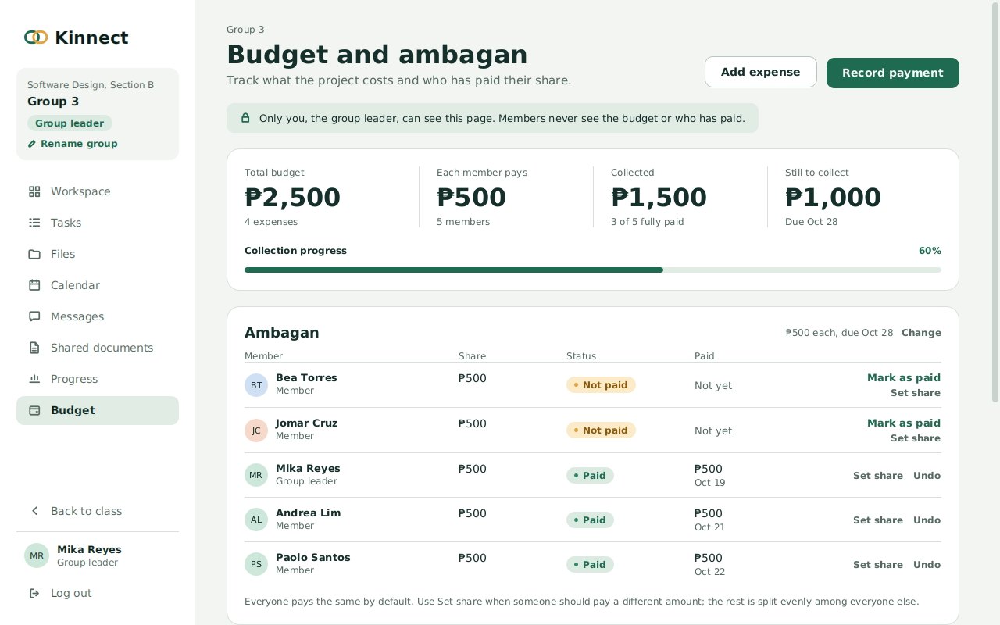

## Rules Kinnect enforces

Kinnect checks these rules before saving anything. If a rule is broken, the form shows a message explaining what to fix.

| Rule | Why |
|---|---|
| A student can be in only one group per class. | Keeps every student's work in one place. |
| Only the professor can create groups, change a leader, or remove members. | The professor stays in control of the class. |
| A member who already has work in the group can't be removed. | No task, file, or payment loses its owner. |
| Only the leader can create tasks and manage the budget. | One person organizes the work and the money. |
| Only the assigned member can change a task's status. | Progress reflects what each member actually reports. |
| Deadlines can't be in the past, and events must end after they start. | Keeps the calendar accurate. |
| Files must be a common document, image, or ZIP type, up to 25 MB. | Keeps the shared storage usable. |
| A payment can't be more than what the member still owes. | Keeps the budget balanced. |

Passwords are never saved as plain text. Kinnect stores a scrambled version (a PBKDF2 hash) that can't be turned back into the password.

## Built with

| Part | Used |
|---|---|
| Language | Java 21 |
| User interface | JavaFX 21, built entirely in Java code |
| Database | MySQL 8 or MariaDB, connected through JDBC |
| Build tool | Maven (Apache NetBeans project) |

## Running Kinnect

You need the JDK 21 or newer, Apache NetBeans, and a MySQL or MariaDB server ([XAMPP](https://www.apachefriends.org/) is the easiest on Windows).

**Step 1.** Download this repository and open the folder in NetBeans.

**Step 2.** Start MySQL in the XAMPP Control Panel.

**Step 3.** Click Clean and Build, then Run. Kinnect creates its database and tables by itself on the first run.

To use a different MySQL server, such as a cloud database that several computers share, copy `kinnect.example.properties`, name it `kinnect.properties`, and enter the server's address, user, and password. To share Kinnect as a Windows app with Java included, choose **exe** in NetBeans' configuration box and click Clean and Build. The app appears in `target\dist\Kinnect`.

### Try it with sample data

On an empty database, Kinnect loads a sample class so you can explore every role. Every password is `kinnect123`.

| Role | Email |
|---|---|
| Professor | elena.cruz@school.edu |
| Group leader | mika.reyes@school.edu |
| Group member | andrea.lim@school.edu |
| Student with no group yet | kevin.tan@school.edu |